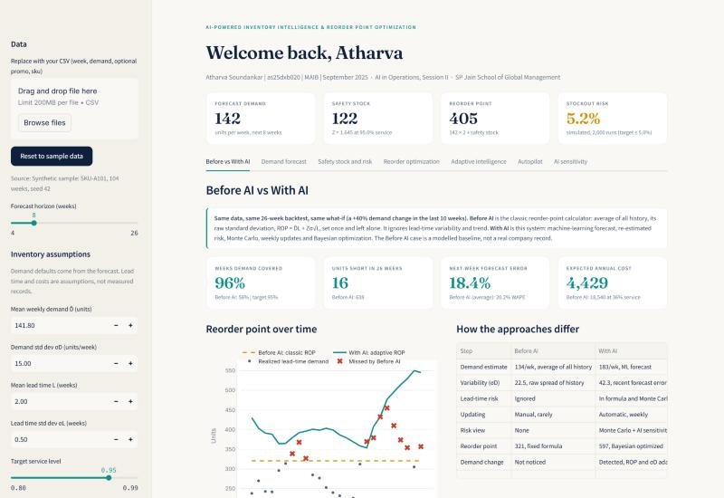
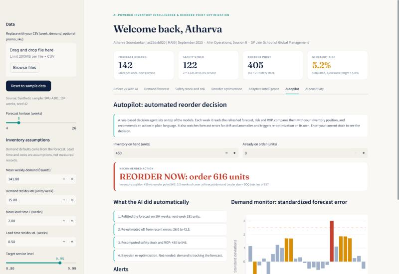
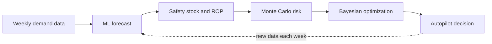

# AI-Powered Inventory Intelligence and Reorder Point Optimization

**An interactive Streamlit dashboard that replaces a static reorder-point calculator with machine-learning forecasts, Monte Carlo risk analysis, Bayesian optimization and an automated weekly decision agent.**


> AI in Operations | Session II: AI Applications in Reorder Point and Inventory Management
> SP Jain School of Global Management

**Live app:** [ai-inventory-intelligence.streamlit.app](https://ai-inventory-intelligence.streamlit.app)

[](https://ai-inventory-intelligence.streamlit.app)



## Why this project

A classic reorder-point calculator uses the average and spread of past demand, sets one number, and leaves it there. When demand shifts, or suppliers run late, that number is wrong and nobody notices until stock runs out or cash is tied up in excess inventory.

This project shows what changes when the same decision is powered by AI: the forecast learns from new data every week, the safety buffer adapts to forecast error and lead-time uncertainty, risk is tested by simulation, and the reorder point is chosen by an optimizer instead of a manual sweep.

## What it does

| Capability | AI technique | Dashboard tab |
|---|---|---|
| Predict demand | Regression with trend, promotions and seasonality, compared with a moving-average baseline on a chronological holdout (MAE, WAPE) | Demand forecast |
| Dynamic safety stock | Analytical formula plus a 2,000-run Monte Carlo with supplier-delay and demand-spike scenarios | Safety stock and risk |
| Optimize the reorder point | Optuna TPE (Bayesian optimization) minimizing ordering, holding and shortage cost under a service-level constraint | Reorder optimization |
| React to demand changes | Weekly refit with recency weighting, re-estimated uncertainty, and automatic re-optimization | Adaptive intelligence |
| Find what matters most | Bayesian worst-case search over the uncertainty range with parameter importance, instead of a grid sweep | AI sensitivity |
| Automate the decision | Rule-based agent: reorder or hold, drift and anomaly alerts, automatic re-optimization trigger | Autopilot |
| Prove the value | Classic calculator against the full AI system on the same backtest | Before vs With AI |

A sidebar **demand-change slider** injects a what-if shift into recent demand, and every AI tab reacts to it.



## How it works



**Safety stock and reorder point**, in consistent weekly units:

```
SS  = Z * sqrt( sigma_D^2 * L + D_bar^2 * sigma_L^2 )
ROP = D_bar * L + SS
```

`Z` is the normal quantile of the target service level, `D_bar` and `sigma_D` are mean weekly demand and its standard deviation, `L` and `sigma_L` are mean lead time and its standard deviation. The forecast supplies `D_bar`, and its holdout error supplies `sigma_D`. The formula assumes roughly normal, independent demand and lead time, which the Monte Carlo then tests directly.

**Optimization objective** (per year): ordering cost + holding cost + expected shortage cost, with order quantity fixed at the EOQ, subject to cycle service level at or above the target. Optuna's TPE sampler searches the integer reorder point sequentially, using constraint feedback to steer away from infeasible values.

## Results snapshot

Default settings: synthetic data, seed 42, 95% target service, 2-week lead time with 0.5-week variability.

| Measure | Result |
|---|---|
| Forecast error, moving average vs best regression (12-week holdout) | 14.2% vs 9.4% WAPE |
| Safety stock / reorder point (analytical) | 122 / 405 units |
| Simulated stockout risk at that ROP | 5.2% (target 5.0%) |
| Same ROP under a supplier delay / demand spike | 54% / 32% stockout risk |
| Bayesian-optimized ROP | about 430 units at about 97% service, lower expected cost than the formula |

With a +40% demand change in the last 10 weeks, the classic fixed reorder point covered 15 of 26 weeks and ran 638 units short. The adaptive AI policy covered 25 of 26 weeks and ran 16 units short, at the cost of holding a higher reorder point on average. When demand is stable, a plain average forecasts almost as well as the model, so the advantage comes from noticing and adapting to change. All figures come from the included synthetic data and illustrative costs.

## Quick start

```bash
git clone <this-repository-url>
cd <repository-folder>
python -m venv .venv
.venv\Scripts\activate        # macOS or Linux: source .venv/bin/activate
pip install -r requirements.txt
streamlit run app.py
```

The dashboard opens at `http://localhost:8501`. To refresh the sample dataset and run the built-in self-checks:

```bash
python inventory.py
```

To run the notebook, also install `matplotlib`, `jupyter` and `nbconvert`, then open `Atharva_Soundankar_as25dxb020_AI_in_Operations_Laboratory_Work_1.ipynb` from the repository root so it can import `inventory.py`.

### Deploy on Streamlit Community Cloud

1. Push this repository to GitHub.
2. On [share.streamlit.io](https://share.streamlit.io), choose **Create app** and select the repository and the `main` branch.
3. Set the main file to `app.py`, pick Python 3.12 under advanced settings, and deploy.

## Project structure

```
.
├── app.py                  Streamlit dashboard (layout, charts, styling)
├── inventory.py            All calculations: forecast, safety stock, Monte Carlo, Optuna, adaptive replay, autopilot
├── data/weekly_demand.csv  Synthetic demand for one SKU, 104 weeks, seed 42
├── Atharva_Soundankar_as25dxb020_AI_in_Operations_Laboratory_Work_1.ipynb   Executed notebook
├── .streamlit/config.toml  Light theme
├── docs/                   README screenshots
└── requirements.txt
```

`app.py` only displays results. Every formula lives in `inventory.py`, so the dashboard and the notebook always agree.

## Data and assumptions

- The demand data is **synthetic**: 104 weekly values for one SKU (`SKU-A101`) with trend, yearly seasonality, random promotions and noise, generated with a fixed seed. It is not observed business data.
- Lead time, lead-time variability, unit cost, holding rate, order cost, shortage cost and service target are **assumptions** that can be changed in the dashboard. Results are optimal for this model only, not for a real company.
- To use your own data, upload a CSV in the sidebar with columns `week` (date), `demand` (zero or more), and optionally `promo` (0 or 1) and `sku`. At least 30 weeks are required, and the app validates dates, values and missing fields.
- The "Before AI" case is a modelled baseline (the textbook calculator), not a record of any company's past practice.

## Limitations

- One SKU, one supplier, and normal approximations for demand and lead time.
- The adaptive replay uses one model family (recency-weighted regression) and whole-week lead times. The demand change is injected, not observed.
- The Autopilot is a rule-based agent, not a learned policy. Lead-time prediction from supplier records, multi-SKU forecasting and supplier risk scoring would need real operational data and are left as extensions.

## Author

**Atharva Soundankar** | as25dxb020 | MAIB, September 2025 batch
SP Jain School of Global Management | AI in Operations
